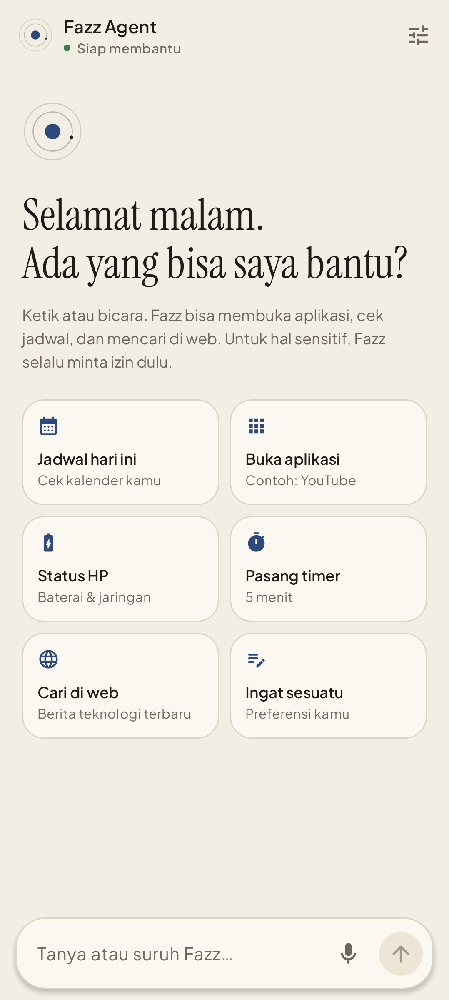
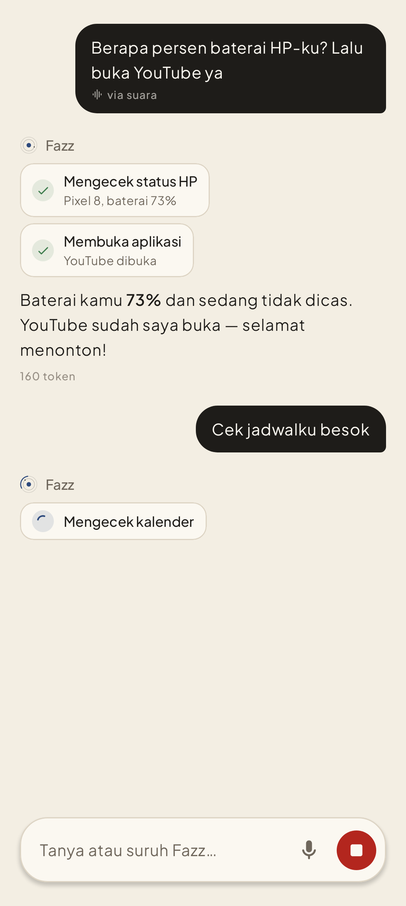
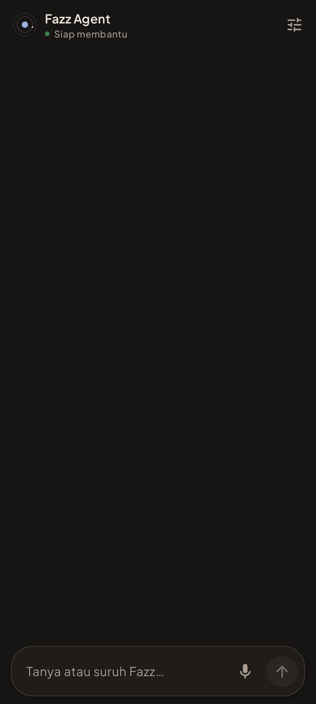

<p align="center">
  
  
  
</p>

# Fazz Agent

**Bilang saja. Fazz yang kerjakan.** Asisten AI untuk HP Android yang bisa diajak ngobrol lewat teks atau suara, lalu bertindak di HP-mu: cek jadwal, buka aplikasi, pasang timer, cari di web. Untuk hal sensitif, Fazz selalu minta izin dulu.

- 🌐 Situs & unduhan: **https://fazz-agent.vercel.app**
- 📦 APK: lihat [Releases](../../releases)
- 🇬🇧 English version: [scroll down](#english)

---

## Bahasa Indonesia

### Fitur (v0.2.0)

| Kamu bilang | Yang Fazz lakukan | Izin |
|---|---|---|
| "Besok aku ada acara apa?" | Membaca kalender lalu merangkum | Kalender + persetujuan |
| "Buatkan rapat Jumat jam 3" | Membuka aplikasi kalender dengan detail terisi (kamu yang menekan Simpan) | Persetujuan |
| "Buka WhatsApp" | Membuka aplikasi yang terpasang | – |
| "Nomor Budi berapa?" | Mencari kontak (maks. 5 hasil) | Kontak + persetujuan |
| "Pasang timer 10 menit" | Timer di aplikasi Jam | – |
| "Baterai tinggal berapa?" | Baterai, jaringan, penyimpanan | – |
| "Cari berita AI terbaru" | Pencarian web dengan sumber (tergantung kuota Gemini) | – |
| "Ingat, aku suka jawaban singkat" | Disimpan ke memori di HP setelah disetujui | Persetujuan |

Lainnya: jawaban streaming, input suara (SpeechRecognizer) dengan indikator mikrofon, jawaban dibacakan (TextToSpeech), riwayat chat, memori yang bisa dilihat/dihapus, tampilan krem minimalis dengan mode gelap otomatis, seluruh UI berbahasa Indonesia.

**Belum ada:** panggilan suara "Hai Fazz", mendengarkan di latar belakang, membaca layar aplikasi lain.

### Cara pasang

1. Unduh APK dari [situs](https://fazz-agent.vercel.app) atau [Releases](../../releases).
2. Buka file-nya; izinkan "pasang dari sumber ini" jika diminta.
3. Buka **Fazz Agent** → Pengaturan → **Tes koneksi**.

### Arsitektur singkat

```
Aplikasi Android (Kotlin + Jetpack Compose)
  └─ AgentOrchestrator ── loop: tanya Gemini → jalankan tool → kirim hasil → ulangi (maks. 8 langkah)
       ├─ ToolExecutor: validasi argumen → cek izin Android → minta persetujuan → timeout → hasil
       └─ SupabaseAiService ──HTTPS──► Supabase Edge Function `agent-chat` ──► Google Gemini
                                         (API key hanya di server, batas harian per perangkat)
```

Keamanan: tidak ada API key AI di dalam APK; model hanya bisa memakai tool yang terdaftar (tidak bisa menjalankan kode); data kalender/kontak dikirim hanya setelah disetujui; password/PIN/nomor kartu ditolak masuk memori.

### Build sendiri

Butuh JDK 17 dan Android SDK (platform 37).

```bash
cp secrets.properties.example secrets.properties   # isi URL & anon key Supabase milikmu
./gradlew assembleDebug          # APK di app/build/outputs/apk/debug/
./gradlew testDebugUnitTest      # 45 unit test + screenshot test
```

Backend: deploy `backend/supabase/functions/agent-chat` ke Supabase, jalankan migrasi di `backend/supabase/migrations`, lalu tambahkan secret `GEMINI_API_KEY` (dari https://aistudio.google.com/apikey).

---

## English

**Fazz Agent** is an Android AI personal agent. Talk or type, and it acts on your phone through a fixed set of safe tools: read your calendar, prepare events, open apps, look up contacts, set timers, check device status, search the web with sources, and remember approved preferences. Sensitive actions always ask for confirmation first.

### Highlights
- **Agent loop with Gemini function calling** – multi-step, max 8 steps, thought-signature safe.
- **Tool executor pipeline** – schema validation → Android runtime permission → user confirmation → timeout → structured result. The model can never run arbitrary code.
- **Secure backend** – a Supabase Edge Function holds the Gemini key server-side, validates requests, enforces a per-install daily limit, and streams SSE back to the app.
- **Voice** – SpeechRecognizer with a clear "microphone on" panel; TextToSpeech replies.
- **User-controlled memory** – stored on device, viewable and deletable; secrets are refused.
- **Design** – cream minimal (Instrument Serif + Plus Jakarta Sans, batik-indigo accent), automatic dark mode, fully Indonesian UI.

### Tech stack
Kotlin · Jetpack Compose · Material 3 · Coroutines/Flow · OkHttp · kotlinx.serialization · DataStore · Supabase Edge Functions (Deno) · Google Gemini API · JUnit · Robolectric + Roborazzi (screenshot tests).

### Build
```bash
cp secrets.properties.example secrets.properties   # your Supabase URL + anon (public) key
./gradlew assembleDebug
./gradlew testDebugUnitTest
# Re-record screenshots: ./gradlew testDebugUnitTest --tests '*ScreenshotTest*' -Proborazzi.record=true
```

### Project layout
```
app/src/main/java/com/fazz/agent/
├── presentation/   Compose UI (chat, settings, memory, theme, components)
├── core/ai/        AiService (provider-neutral) + Supabase/Gemini client + SSE parser
├── core/agent/     AgentOrchestrator, SystemPrompt, HistoryTrimmer
├── core/tools/     Registry, executor, schema validator, Android tools
├── core/voice/     Speech input / text-to-speech
├── data/local/     Settings (DataStore), memory & conversation files
└── domain/models/
backend/supabase/   Edge Function + SQL migration
web/                Landing page (Vercel)
```

### Limitations
No wake word or background listening yet (Android requires a foreground service with a persistent notification for background mic use). Web search depends on Gemini grounding quota. Not on Google Play.

### License
[MIT](LICENSE)
